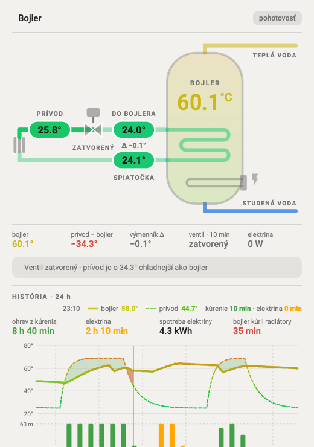

# Bojler TUV Card

A Home Assistant dashboard card for a combined hot-water boiler (bojler) that can be heated two ways: by its electric element, or by water from the central-heating circuit through a coil, switched by a valve.



The card draws the boiler, the coil, the valve and the electric element. Pipe colors follow their temperature, from blue (0 °C) to red (80 °C). While the valve is open, moving dashes show the water flowing.

It also tells you what is going on:

| Status | When |
|---|---|
| **ohrev z kúrenia** (green) | Valve open and the heating water is warmer than the boiler |
| **bojler kúri radiátory** (red) | Valve open but the heating water is colder than the boiler, so the boiler is heating your radiators |
| **kúrenie je teplé** (blue) | Valve closed although the supply is warmer than the boiler by at least `min_delta` |
| **elektrický ohrev** (orange) | The electric element is on and the heating water is too cold to help |
| **pohotovosť** (grey) | Nothing is heating |

Below the drawing, a history section (last 24 hours by default) shows:

- **Summary:** how long the heating water heated the boiler, how long the electricity did, the electricity used in kWh, and, only if it happened, how long the boiler was heating the radiators.
- **Boiler vs. supply graph:** boiler as the thick line, supply as the thin one; green area where the heating water was warmer than the boiler, red where the valve was open although it was colder.
- **Hourly bars:** minutes per hour heated by the heating water (green) and by electricity (orange).

The values row under the drawing shows **prívod − bojler** (supply minus boiler: positive means the heating water is warmer and worth using) and **výmenník Δ** (into the coil minus out of it: how much the water cooled in the boiler, shown only while the valve is open). Hover a value to see the calculation.

Move the mouse or a finger over the graph to read the values at that time. Click any temperature, the valve or the element in the drawing to open its history in Home Assistant. The labels are in Slovak, and you can rename the pipe labels in the editor.

## Install with HACS

1. HACS → ⋮ (top right) → **Custom repositories**
2. Repository: `https://github.com/Thoky81/bojler-tuv-card`, type **Dashboard** → **Add**
3. Search for **Bojler TUV Card** in HACS → **Download**
4. Reload the browser (on the Companion app, pull down to refresh)

## Add the card

Edit a dashboard → **Add card** → search for **Bojler + TUV**. Pick the entities in the editor. Everything can be set there, no YAML needed.

Or in YAML:

```yaml
type: custom:bojler-tuv-card
boiler: sensor.bojler_temp_tuv_bojler          # boiler water temperature (required)
supply: sensor.tuv_sensors_tuv_pipe_near       # heating supply, before the valve
coil_in: sensor.bojler_temp_tuv_pipe           # after the valve, into the boiler coil
coil_out: sensor.tuv_sensors_tuv_pipe_near_2   # out of the coil, back to the heating
valve: switch.tuv_bojler_valve                 # switch, valve, binary_sensor or input_boolean (required)
heater_power: sensor.bojler_power              # electric element power in W
```

### All options

| Option | Default | What it does |
|---|---|---|
| `title` | `Bojler` | Card title |
| `boiler` | — | Boiler water temperature sensor (required) |
| `supply` | — | Heating supply temperature, before the valve |
| `coil_in` | — | Temperature after the valve, going into the coil |
| `coil_out` | — | Temperature coming out of the coil |
| `valve` | — | Valve entity; `on` / `open` counts as open (required) |
| `heater_power` | — | Electric element power sensor (W) |
| `heater` | — | Electric element on/off entity, if you have no power sensor |
| `heater_on_w` | `50` | Power above which the element counts as heating |
| `cold` / `hot` | `0` / `80` | Temperatures drawn fully blue / fully red |
| `min_delta` | `3` | How much warmer (°C) the supply must be to count as useful |
| `reverse_tol` | `0.5` | Tolerance (°C) before the "boiler heats radiators" alarm |
| `animate` | `true` | Moving dashes in the pipes while the valve is open |
| `show_header` / `show_stats` / `show_banner` | `true` | Show the header, the values row and the status bar |
| `show_graph` | `true` | Show the history section |
| `graph_hours` | `24` | Hours of history (1–168) |
| `graph_smooth` | `20` | Minutes of rolling average for the graph lines, so a cycling heat source doesn't zigzag (`0` = raw readings) |
| `label_supply` / `label_coil_in` / `label_coil_out` | `PRÍVOD` / `DO BOJLERA` / `SPIATOČKA` | Pipe labels |

## Performance

The card redraws only when one of its own entities changes, not on every Home Assistant update. The history reads Home Assistant's 5-minute statistics (288 points per sensor per day) instead of the raw sensor history, loads once, then adds new readings from live updates and redraws at most once a minute. The boiler, supply and power sensors need a `state_class` (most temperature and power sensors have one); without it the card falls back to the raw history. The flow animation is plain CSS, limited to about 7 repaints per second because Safari repaints animated SVG on every frame. Set `animate: false` to turn it off on slow wall tablets.

## Without HACS

[`button-card/bojler-tuv-card.yaml`](button-card/bojler-tuv-card.yaml) is the same card (without the history section) as a [button-card](https://github.com/custom-cards/button-card) template, if you would rather paste YAML than install a card.

## Development

The card is generated from the files in `src/`:

```sh
python3 generate.py   # builds bojler-tuv-card.js, preview.html and the button-card YAML
```

Open `preview.html` in a browser to try all states with simulated values. It also shows three other layouts (B, C, D) that were considered; `python3 generate.py --yaml B` builds one of them as button-card YAML.
